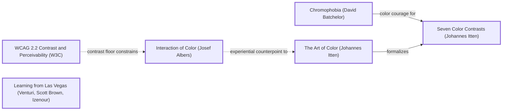

# DESIGN-LOG: website-toolkit (DADA run, 2026-11-11)

## Traversal Plan

**Brief:** "Site repo is b plus good design boring colors do a new color version in this repo" (the owner, verbatim). Make a new colour version of the site-repo kit in a new repository, keeping the design the owner graded B+.

**Mode: Adaptive.** The site serves people and agents.

**Run type: Full**, with the design held constant by the brief: layout, parts, sprue, X-ray and sandbox stay; colour is free. Moves outside colour are limited to measured defects inherited from site-repo's R2 panel.

**Bound:** none stated.

**Lineage:** site-repo, whose DADA log and panels R0–R2 are in SolutionsAsService/site-repo (DESIGN-LOG.md, panel/). Its open findings are this run's starting Frontier.

### Tooling

The tools are the same as for site-repo:
- Mermaid text in the log
- one Agent sub-agent per seat, three at a time, filing to panel/<round>/
- collect_panel.py and pick_panel.py
- Playwright through build/check.mjs
- the ledger in SolutionsAsService/dada-changes (the owner's account)

### Panel (pick_panel.py --mode adaptive --run-type full --project website-toolkit)

| Seat | Why |
|---|---|
| Critic: Provocateur (Debord) | required |
| Critic: Provocateur (Shklovsky) | required |
| Critic: Inclusion (Holmes) | required |
| Critic: Inclusion (Mace) | required |
| Critic: Evidence (Cairo) | required, measurement |
| Critic: Usability (Krug) | rated |
| Critic: Craft (Bringhurst) | rated |
| Critic: Semiotic (Eco) | rotation, 0 rounds on record |

Dotted pairs: Debord–Krug, Shklovsky–Krug.

### Seed

- **Stance:** Chromophobia (David Batchelor). Diagnosis: the B+ was withheld for fear of colour ("boring colors").
- **Rules:**
  - The Art of Color (Johannes Itten) -->|formalizes| Seven Color Contrasts (Johannes Itten).
  - WCAG 2.2 Contrast and Perceivability (W3C).
- **Breaker:** Learning from Las Vegas (Venturi, Scott Brown, Izenour). Colour as the sign of the decorated shed.
- **Counterpoints (dotted):**
  - `albers -.->|experiential counterpoint to| itten`: Interaction of Color (Josef Albers).
  - `wcag -.->|contrast floor constrains| albers`.

Chain:

> Chromophobia (David Batchelor) -->|color courage for| Seven Color Contrasts (Johannes Itten) · The Art of Color (Johannes Itten) -->|formalizes| Seven Color Contrasts (Johannes Itten) · Interaction of Color (Josef Albers) -.->|experiential counterpoint to| The Art of Color (Johannes Itten) · WCAG 2.2 Contrast and Perceivability (W3C) -.->|contrast floor constrains| Interaction of Color (Josef Albers).

### Initial Frontier

| Candidate | Reached via | Status |
|---|---|---|
| The owner's grade: colour | premortem (R0) | TAKEN (M1–M3) |
| Contrast of hue as the organizing contrast (one colour per group) | itten -->\|formalizes\| itten7 | TAKEN (M2) |
| Colour courage on the first screen | chromo -->\|color courage for\| itten7 | TAKEN (M1) |
| Colours judged in context, not in isolation (each colour beside its neighbours) | albers -.-> itten | TAKEN (M3: four part themes checked in place) |
| The contrast floor | wcag -.-> albers | TAKEN (M4: chrome contrast probed) |
| site-repo R2 open findings | inherited panel | TAKEN (M5) |

## Panel, round R0 (inherited premortem)

No new R0 panel was convened. The inherited artifact had just been judged by site-repo's R2 panel (7 of 8 seats filed at the time of copying; Mace's file was still out). The owner then graded it B+, with words naming the defect: "good design boring colors". Recorded as inherited, not re-run:

| Critic | Anchor used | Observed in the work | Verdict | Requested change |
|---|---|---|---|---|
| Critic: Evidence (Cairo) | How Charts Lie | stats.html claims a check that does not exist; the ring branch has no failing fixture; `\b` slot matching | OBJECT | Probe or drop; fixture; exact tokens |
| Critic: Provocateur (Debord) | Society of the Spectacle | "Speakers" leads to a testimonial; the untested "five minutes" | PASS | Rename; drop the timing |
| Critic: Inclusion (Holmes) | Mismatch | Bare unglossed on the phone; on the phone the visual order differs from the DOM order | PASS | Gloss; DOM order |
| Critic: Usability (Krug) | Don't Make Me Think | Phone switches unlabelled; sparse miniatures | PASS | Labels; zoom |
| Critic: Craft (Bringhurst) | Elements of Typographic Style | Step numerals past the margin; widows; .chk about 80 characters per line; no scale | PASS | Fixes; a scale |
| Critic: Provocateur (Shklovsky) | Art as Technique | Bare answered; tags unreadable at miniature scale | PASS | Optional zoom |

### Resolutions R0

| Finding | Resolution |
|---|---|
| Owner: boring colours | ADAPT (M1–M3) |
| Cairo: stats claim without a probe | ADAPT (M5): probe "every stat has a source line", with a failing fixture |
| Cairo: ring branch untested | ADAPT (M5): the fixture has a 2 px ring at 1.1:1 and it fails |
| Cairo: `\b` slot match | ADAPT (M5): exact whitespace tokens |
| Debord: Speakers; five minutes | ADAPT (M5): "Voices"; "step by step" |
| Holmes: phone gloss; order | ADAPT (M5): one-line gloss on the phone; the doors follow the frame in the DOM; the reorder is gone |
| Krug: phone labels; sparse miniatures | ADAPT (M5): "Theme"/"View" labels on the phone; narrower virtual widths for nav, breadcrumb and dividers |
| Bringhurst: numerals, widows, measure | ADAPT (M5): padding 2.4em; `text-wrap: pretty`; .chk 34em |
| Bringhurst: type scale | DEFERRED (Open frontier) |
| Shklovsky: tags unreadable in Bare at miniature scale | DEFERRED (the part pages carry the full X-ray) |

## Decision Records

## Move M1: Ultramarine and acid yellow  (BREAK)
Depends on: none
Anchors: Stance Chromophobia (David Batchelor) | Breaker Learning from Las Vegas (Venturi, Scott Brown, Izenour)
Intent:
- The landing band and the header become ultramarine (#2330d6).
- The frame, runners and pressed controls become acid yellow (#e4ff3a).
- Text on the band is white (7.7:1), and secondary text is #dfe2ff (6.4:1).
- Content pages move from beige to a violet-white (#f7f5ff); code blocks become deep blue; the footer becomes ink with yellow links.
Formal argument: Batchelor: the B+ was the fear of colour, so colour carries the whole sign of the shed (Venturi). The structure the owner liked is untouched.
Alternatives rejected:
- (a) A brighter orange on beige. Rejected: the same palette, louder.
- (b) A dark mode. Rejected: dark is not colour.
- (c) A gradient. Rejected: it fights the parts' own colours.
Consequence: The parts' own colours sit on a strong ground, so the tiles stay white with ink borders to separate them.
Fence: Quiet chrome exists so the content leads. The frame is loud, and the tiles are still white.
Frontier effect: chrome contrast must be measured (M4).
Mode field: The advanced pole is a saturated, two-colour ground. The acceptable pole is white tiles and white text at 7.7:1.

## Move M2: One colour per group  (KEEP-THE-RULE)
Depends on: M1
Anchors: Rule Seven Color Contrasts (Johannes Itten) (contrast of hue) | Rule The Art of Color (Johannes Itten)
Intent: The seven runner tags, the part-code chips and the parts index letters each take a hue:
- A coral
- B pink
- C mint
- D sky
- E amber
- F lilac
- G yellow

All carry ink text, so hue is a second channel and never the only one, since the letters stay.
Formal argument: Itten's contrast of hue is the strongest of the seven when the hues are saturated and separated, and it makes the groups findable at a glance.
Alternatives rejected:
- (a) One accent for all groups. Rejected: no wayfinding.
- (b) Tints of blue. Rejected: too close.
Consequence: Seven hues plus the ground must each hold ink text at 4.5:1 or better.
Fence: n/a.
Frontier effect: the forced-colours check.
Mode field: The advanced pole is a seven-hue kit. The acceptable pole is the letters still there.

## Move M3: Four new part themes  (KEEP-THE-RULE)
Depends on: none
Anchors: Counterpoint Interaction of Color (Josef Albers) (dotted from The Art of Color)
Intent: Replace Paper, Night, Citrus and Slab with:
- **Signal** (default): warm white, violet #5a2ee5, lilac surfaces.
- **Riso**: fluoro pink #d6005f on yellow.
- **Cobalt**: dark, with an acid-yellow accent.
- **Mint**: deep green #007a52 on mint.

The parts' built-in fallbacks move to Signal.
Formal argument: Albers says colour is judged in its neighbours. Each theme is checked with every part rendered in it, not swatch by swatch.
Alternatives rejected:
- (a) Keep the old themes and add one. Rejected: the default would still be beige.
- (b) Theme-free parts. Rejected: tokens are the programme.
Consequence: The theme switch and the sandbox presets change names. The sandbox hash uses `th=riso` and similar.
Fence: n/a.
Frontier effect: the check runs every part in every theme.
Mode field: The advanced pole is fluoro and dark themes. The acceptable pole is a calm default (Signal).

## Move M4: Measure the chrome  (KEEP-THE-RULE)
Depends on: M1, M2
Anchors: Rule WCAG 2.2 Contrast and Perceivability (W3C) (dotted "contrast floor constrains" Albers)
Intent: The text-contrast probe now runs on the site's own 25 pages as well as on the parts. Disabled controls are exempt (WCAG 1.4.3).
Formal argument: A new palette must prove its floor, not assert it in comments.
Alternatives rejected:
- (a) Trust the hand calculations in the CSS comments. Rejected: they are comments, not measurements.
Consequence: The first run found the disabled ↑/↓ at 1.98:1, which is exempt under 1.4.3, so the probe now skips disabled controls.
Fence: n/a.
Frontier effect: none.
Mode field: n/a.

## Move M5: Inherited fixes  (KEEP-THE-RULE)
Depends on: M1
Anchors: Rule WCAG 2.2 Contrast and Perceivability (W3C)
Intent: The R0 resolutions above, item by item.
Formal argument: Each is a measured defect from site-repo R2.
Alternatives rejected:
- (a) Leave them in site-repo. Rejected: this repo is the version going forward.
Consequence: About 15 small edits.
Fence: n/a.
Frontier effect: R1 re-judges them.
Mode field: n/a.

---

## Panel, WHOLE, round R1 (commit after 0f… "R1 evidence"; panel/R1/*.png; evidence panel/R1/evidence.md)

6 of 8 seats filed:
- Critic: Craft (Bringhurst) was **NOT CONVENED**: launching the seat was refused by the session's permission check ("Create Public Surface"). It was not retried and is not counted as a pass.
- Critic: Semiotic (Eco), the rotation seat, was not launched for the same reason.

| Critic | Anchor used | Observed in the work | Verdict | Requested change |
|---|---|---|---|---|
| Critic: Evidence (Cairo) | How Charts Lie | 12/12 and 18/18 reproduced; part palettes measured (accents 4.82–14.09). The CSS comments misstate ratios (7.7 vs 8.52; 17 vs 16.66; 6.4 vs 6.68). **Footer focus ring 1.00:1; Copy ring 1.10:1.** Site pages were never focus-probed. The 746 web-font figure has no method | OBJECT | Correct the comments; yellow rings on dark; probe focus on site pages; state the font condition |
| Critic: Provocateur (Debord) | Society of the Spectacle | No stale site-repo claims in the site. The stylesheet header still says "signal orange on drafting paper"; the probe is still named `citrus`; `sr` unexplained | OBJECT | Rewrite the header; rename; one line in AGENTS.md |
| Critic: Provocateur (Shklovsky) | Art as Technique | The ultramarine ground breaks the beige habit. But seven equal hues read as a legend; the theme switch recolours only the cards; the Signal parts are still cream | OBJECT | Rank the hues; the theme recolours the whole object; a coloured ground for Signal |
| Critic: Inclusion (Mace) | Principles of Universal Design | Real-Tab test: the yellow rings on blue work. **Footer ring 1.00:1 on all pages; pressed theme/view lost in forced colours** | OBJECT | Yellow footer ring; probe the site pages; a forced-colours pressed state |
| Critic: Inclusion (Holmes) | Mismatch | Contrast and the letter cues work for low vision and colour-vision differences. **Parts index colours shifted by one group** (`nth-of-type` counts the page head); no calmer way in for migraine or visual stress | OBJECT | Key by data-group; a prefers-contrast calm view |
| Critic: Usability (Krug) | Don't Make Me Think | Colour passes "what is this". It does not say where to start: the frame outshouts the doors; on the phone, "All 18 parts" outranks "Start here"; **step numerals 1.57:1** (the probe misses ::marker); yellow means six things | OBJECT | Start here as the one filled door; outline "All 18 parts"; numerals in the ground colour |

**Andon:** none.

### Resolutions R1

| Finding | Resolution |
|---|---|
| Cairo + Mace: footer ring 1.00:1; Copy ring 1.10:1 | ADAPT (M6): two-tone focus (yellow outline with an ink band) on every coloured surface; elsewhere an ink ring with a white band |
| Cairo + Mace: focus never probed on the site pages | ADAPT (M6): focusProbe runs on all 25 site pages (up to 160 Tabs). The ring is judged against what is painted just outside each side (elementsFromPoint), not the parent's background; a two-tone ring passes when its tones differ by 3:1; preview iframes are skipped (their contents are probed as parts) |
| Krug: step numerals 1.57:1; the probe misses markers | ADAPT (M6): numerals in the ground colour; a list-marker contrast probe, with a failing fixture |
| Cairo + Debord: the CSS comments misstate ratios; stale header; `citrus` | ADAPT (M6): comments re-measured (8.5, 16.7, 6.7); header rewritten; renamed `riso` |
| Cairo: the 746 web-font figure has no method | ADAPT (M6): the evidence states the condition; the check reports the fallback-font figure only |
| Debord: `sr` unexplained | ADAPT (M6): AGENTS.md explains the prefix |
| Holmes: parts-index colours off by one | ADAPT (M6): keyed by `data-group`, not position |
| Holmes: no calm way in | ADAPT (M6): `prefers-contrast: more` turns the ground to a pale tint with ink text |
| Mace: pressed state lost in forced colours | ADAPT (M6): `[aria-pressed=true]` uses SelectedItem in forced colours |
| Shklovsky: the theme switch recolours only the cards | ADAPT (M7, BREAK): the theme buttons set `html[data-kit]`, which recolours the header, band and frame (Riso hot pink #c4005a, Cobalt #101a5c, Mint #006b48); contrast is probed in every colourway |
| Shklovsky: Signal parts still cream | ADAPT (M7): Signal paper #f4f0ff, surface #e4daff (lilac) |
| Shklovsky + Krug: hues unranked; yellow means six things | ADAPT (M7): group G is white, not the frame's yellow; yellow is kept for the frame, pressed state, focus on dark, and the one filled door |
| Krug: where to start | ADAPT (M7): "Start here" is the only filled (yellow) door; "All 18 parts" becomes an outline |

## Move M6: Focus and claims on the new colours  (KEEP-THE-RULE)
Depends on: M1, M4
Anchors: Rule WCAG 2.2 Contrast and Perceivability (W3C) | Counterpoint Interaction of Color (Josef Albers)
Intent: The resolutions above for Cairo, Mace, Holmes, Krug and Debord.
Formal argument: Albers again: a ring's colour is only as visible as its neighbours. Hence two-tone rings, and a probe that looks at what is actually beside each side.
Alternatives rejected:
- (a) A white ring everywhere. Rejected: it fails on the white tiles.
- (b) Exempting the dark areas. Rejected: those are where people tab.
Consequence: The check takes longer (site pages Tabbed through).
Fence: n/a.
Frontier effect: R2.
Mode field: n/a.

## Move M7: The whole object changes colour; one door is lit  (BREAK; S4 push)
Depends on: M1, M2, M3
Anchors: Stance Chromophobia (David Batchelor) | Rule Seven Color Contrasts (Johannes Itten) (contrast of hue, and Itten's contrast of extension: one small lit area against a large ground)
Intent:
- The theme buttons recolour the ground, header and frame along with the parts.
- Signal gets a lilac ground.
- Group G turns white, so yellow is rationed.
- "Start here" becomes the one filled yellow door.
Formal argument: Batchelor's courage: colour must move the whole sign, not decorate a corner (Shklovsky F3). Itten's contrast of extension: a small saturated area (the one door) leads the eye against a large ground (Krug F2).
Alternatives rejected:
- (a) A separate "colourway" control. Rejected: one switch is the device.
- (b) Seven hues ranked by size. Rejected: the groups are equal.
Consequence: Each colourway needs its own on-ground text colour, probed (13/13).
Fence: Equal hues exist for wayfinding. They stay, but yellow is withdrawn from them.
Frontier effect: R2.
Mode field: The advanced pole is that the kit changes colour as a whole. The acceptable pole is that every colourway passes the contrast probe, and a calm view exists.

---

## Panel, WHOLE, round R2 (commit 3db7305; panel/R2/*.png; evidence panel/R2/evidence.md)

6 of 8 seats filed. Bringhurst and Eco were again NOT CONVENED (launch refused by the permission check in R1; not retried).

| Critic | Anchor used | Observed in the work | Verdict | Requested change |
|---|---|---|---|---|
| Critic: Usability (Krug) | Don't Make Me Think | "Start here" now leads; "All 18 parts" demoted; numerals fixed. Filled yellow still also means a pressed toggle | PASS | Pressed toggles not yellow |
| Critic: Provocateur (Debord) | Society of the Spectacle | R1 fixes hold. The two-tone wording is looser than the code; markers missing from PROBES; a duplicated rule; a ring with no sample passes | PASS | Tighten; list markers; dedupe; fail on no sample |
| Critic: Provocateur (Shklovsky) | Art as Technique | The theme recolours the whole object. The spines are constant across colourways; Signal and Riso parts still read as paper | OBJECT | Spines follow the colourway; non-paper grounds |
| Critic: Inclusion (Holmes) | Mismatch | Group colours fixed. **The calm mode turns `--ground` into paper: buttons, kickers and numerals vanish on inner pages**; calm is only an OS setting | OBJECT | A token that never goes pale; an in-page Calm switch; probe calm |
| Critic: Inclusion (Mace) | Principles of Universal Design | Footer, Copy and frame rings pass all sides in every colourway; forced colours pressed state fixed. In calm: the gloss code and pressed buttons drop to 1.08:1; calm never probed | OBJECT | Ink in calm; probe with contrast 'more' |
| Critic: Evidence (Cairo) | How Charts Lie | Comments now true. **The two-tone rule passes drop shadows and 3:1 tones** (C40 asks 9:1); no fixture for the exemptions; the iframe skip contradicts its comment; ancestors excluded behind the ring; markers held to 3:1 | OBJECT (the instrument) | Strict two-tone; fixtures; fix the comment; fail on no sample; 4.5 for small markers |

**Andon:** none.

### Resolutions R2

| Finding | Resolution |
|---|---|
| Holmes + Mace: calm mode hides controls; never probed | ADAPT (M8): `--brand` (ultramarine) for buttons, kickers, chips and numerals never turns pale; calm restyles only the landing's large surfaces to ink on pale; a probe runs every site page under `prefers-contrast: more` and under the Calm switch |
| Holmes: calm only from the OS | ADAPT (M8): a Calm button on the frame bar, remembered per browser (localStorage, guarded), applied on every page |
| Krug: yellow means "pressed" too | ADAPT (M8): pressed toggles are white with a ✓; filled yellow is the first door only |
| Shklovsky: constant spines | ADAPT (M8, BREAK): each colourway has its own spine set (Riso pinks and yellows; Cobalt blue tints with one yellow group; Mint greens with one yellow group); Signal keeps the seven-hue kit |
| Shklovsky: Signal and Riso read as paper | ADAPT (M8): Signal paper #ebe3ff and surface #dacbff; Riso paper #ffd6e8 (pink) and accent darkened to #ad004a, so links hold 4.5:1 (measured: the first try, #d6005f, failed at 3.98) |
| Cairo + Debord: two-tone too generous | ADAPT (M8): a band counts only with zero offset, zero blur, not inset, spread ≥ 1 px, and 9:1 from the outline (C40); fixtures for a drop shadow and for 3.35:1 tones fail |
| Cairo: the iframe skip contradicts its comment | ADAPT (M8): only part-preview frames are skipped; any other focusable iframe fails (fixture); comment corrected; iframes counted in the Tab budget (the fixture first passed because the budget missed them) |
| Cairo + Debord: ring with no sampled side passes | ADAPT (M8): it fails |
| Cairo: ancestors excluded behind the ring | ADAPT (M8): ancestors count as what lies behind |
| Cairo: markers at 3:1 | ADAPT (M8): 4.5:1 unless large |
| Debord: PROBES lacks markers; duplicated rule | ADAPT (M8): PROBES lists markers; duplicate removed |

## Move M8: Calm that works, spines that follow, a strict instrument  (BREAK for the spines; the rest KEEP-THE-RULE)
Depends on: M6, M7
Anchors: Stance Chromophobia (David Batchelor) | Counterpoint Interaction of Color (Josef Albers) | Rule WCAG 2.2 Contrast and Perceivability (W3C)
Intent: The resolutions above.
Formal argument:
- Albers: the spines are judged against each colourway's ground, so they change with it.
- Batchelor's courage is kept: calm is an opt-in, not the default.
- WCAG C40 sets the two-tone rule.
Alternatives rejected:
- (a) Drop calm. Rejected: it is a mismatch for people with visual stress (Holmes).
- (b) Rank the hues by size. Rejected: the groups are equal.
Consequence: Two calm blocks (the media query and the switch) carry the same rules, copied by hand (corrected in R3: they are not one generated set). A test covers both.
Fence: n/a.
Frontier effect: R3.
Mode field: The advanced pole is that the whole kit recolours, spines included. The acceptable pole is a calm switch that keeps every control visible, measured.

---

## Panel, WHOLE, round R3 (commit e18947e; panel/R3/*.png; evidence panel/R3/evidence.md)

6 of 8 seats filed. Bringhurst and Eco: NOT CONVENED (permission refusal in R1, not retried).

| Critic | Anchor used | Observed in the work | Verdict | Requested change |
|---|---|---|---|---|
| Critic: Usability (Krug) | Don't Make Me Think | Landing: one yellow door, pressed toggles white with ✓; five-second and trunk tests pass. Part pages still fill pressed toggles yellow; the check box is about 85 words; Calm has no ✓ | PASS | ✓ toggles everywhere; one-line check; ✓ on Calm |
| Critic: Evidence (Cairo) | How Charts Lie | Ran 14/14. Strict two-tone, fixtures, iframe skip and no-sample all hold. Gaps in cases the site does not use: outline alpha not checked; band not required to reach the outline; stale 3:1 comment; calm probe sets the attribute instead of clicking | PASS | Alpha 1; spread ≥ offset; delete the comment; click the switch |
| Critic: Provocateur (Debord) | Society of the Spectacle | R2 resolutions hold. "No saturated colour, on every page" is false: --brand stays blue, and Cobalt/Mint spines override calm (cascade order); "share one rule set" overstates two copied blocks; stale comment | OBJECT | Honest wording or calm the spines; probe calm per colourway; reword the log |
| Critic: Provocateur (Shklovsky) | Art as Technique | Riso, Cobalt and Mint spines follow the colourway, and the yellow C spine joins the frame; lilac and pink are no longer paper. Signal, the default, keeps the rainbow legend | OBJECT | Signal spines: violet tints and one yellow group |
| Critic: Inclusion (Holmes) | Mismatch | Calm no longer erases controls; the probe covers it. The switch is only on the landing; yellow fills on inner pages in calm; the gloss is title-only | OBJECT (narrow) | Switch in the header on every page; white fills in calm; aria-describedby |
| Critic: Inclusion (Mace) | Principles of Universal Design | 222 real-Tab stops. Calm switch and Cobalt pass. **Under contrast: more, the part-card ring is volt on pale (1.13:1)**, because the later two-tone rules override the earlier calm rules | OBJECT | Calm rules after the two-tone rules |

**Andon:** none.

### Resolutions R3

| Finding | Resolution |
|---|---|
| Mace + Debord: calm rules lose the cascade (ring 1.13:1; spines override calm) | ADAPT (M9): every calm rule moved to the end of the stylesheet; spine, chip and runner fills turn white in calm; probe: calm (both ways in) in every colourway, with spines required neutral and focus probed |
| Holmes: switch only on the landing | ADAPT (M9): the Calm switch is in the header on every page, remembered |
| Holmes: yellow fills in calm on inner pages | ADAPT (M9): pressed toggles, big chips and Copy turn white with an ink inset in calm |
| Holmes: title-only gloss | ADAPT (M9): aria-describedby to a description |
| Debord: the Calm promise overstates | ADAPT (M9): the description now says "a pale frame and ink type on every page; controls stay blue and the parts keep the theme you chose" |
| Debord: "share one rule set" | ADAPT (M9): the log and CSS comment now say "two blocks carry the same rules", and the probe tests both |
| Debord + Cairo: stale 3:1 comment | ADAPT (M9): deleted |
| Cairo: outline alpha unchecked; band need not reach the outline | ADAPT (M9): the outline must be opaque (fixture: an 8%-alpha outline fails); the band spread must be at least the outline offset |
| Cairo: probe sets the attribute | ADAPT (M9): the probe clicks the header switch |
| Krug: pressed toggles yellow on part pages; no ✓ on Calm | ADAPT (M9): pressed toggles are ink with ✓ everywhere outside the frame; Calm gets the ✓ |
| Krug: the check box is long | ADAPT (M9): one line ("Passes every check at 375, 768, 1280 px in 4 themes") with the probes in a details element |
| Shklovsky: Signal keeps the rainbow spines | OVERRULE (Adaptive, MAYA): Signal is the first screen for people who have not met the kit, and its seven hues are a second wayfinding channel beside the letters (Holmes R1 F2 / R2 F2 confirmed the letters carry it and contrast holds; the hues were not separately tested — corrected after Shklovsky R4 F1). The ranked, estranged spines are one click away in the other three colourways. The acceptable pole holds the default; the advanced pole is a press away |

## Move M9: Calm wins, everywhere; the instrument closes its gaps  (KEEP-THE-RULE)
Depends on: M8
Anchors: Rule WCAG 2.2 Contrast and Perceivability (W3C) | Counterpoint Interaction of Color (Josef Albers)
Intent: The resolutions above.
Formal argument: A mode chosen for access must win every conflict, so it goes last in the cascade and is tested in every combination.
Alternatives rejected:
- (a) `!important` everywhere in calm. Rejected: brittle.
- (b) A separate calm stylesheet. Rejected: one more file to keep in sync.
Consequence: The header carries a fourth control. On the phone the nav wraps to two rows; the first screen still fits (probe).
Fence: n/a.
Frontier effect: R4.
Mode field: n/a.

---

## Panel, WHOLE, round R4 (commit e3b7f66; panel/R4/*.png; evidence panel/R4/evidence.md)

6 of 8 filed. Bringhurst and Eco: NOT CONVENED (permission refusal in R1, not retried).

| Critic | Anchor used | Observed in the work | Verdict | Requested change |
|---|---|---|---|---|
| Critic: Inclusion (Holmes) | Mismatch | The switch is on every page and remembered; calm pressed states white; aria-describedby. Sighted phone users see the bare word "Calm" | PASS | Optional visible gloss |
| Critic: Provocateur (Debord) | Society of the Spectacle | Calm wins in every colourway; the test proves it. The wording "controls stay blue" is too broad; the log names "Copy" loosely; M8's "one rule set" unamended | PASS | Reword; annotate M8 |
| Critic: Usability (Krug) | Don't Make Me Think | ✓ means pressed everywhere; one-line check; five-second and trunk tests pass | PASS | none |
| Critic: Provocateur (Shklovsky) | Art as Technique | The device is no longer buried: one press shows the cast object. The overrule partly holds, but "Holmes confirmed" overstates the evidence | PASS | Optional: yellow C spine in Signal |
| Critic: Inclusion (Mace) | Principles of Universal Design | R3 F3 fixed: 36 card stops at 14.69:1 under contrast more; the header switch works by keyboard. Skip link volt in calm, minor | PASS | Optional: ink skip ring in calm |
| Critic: Evidence (Cairo) | How Charts Lie | Reproduced 14/14. Fixes F4–F7 hold. **Calm leaves the parts-index letters coloured** (the group-keyed rule is more specific than calm); the spine probe only covers the landing; it does not assert that the click set calm; a negative offset still passes two-tone | OBJECT | Specific calm rule; probe `.gl` everywhere; assert calm; offset ≥ 0 |

**Andon:** none.

### Resolutions R4

| Finding | Resolution |
|---|---|
| Cairo: parts-index letters stay coloured in calm | ADAPT (M10): `html[data-calm] .pgroup[data-group] .gl` (and the media twin) white |
| Cairo: spine probe only on the landing | ADAPT (M10): spine, chip and letter fills checked on every site page in both calm modes |
| Cairo: click not asserted | ADAPT (M10): the probe asserts `data-calm` after each click |
| Cairo: negative offset passes two-tone | ADAPT (M10): outline-offset ≥ 0 required |
| Debord: "controls stay blue" | ADAPT (M10): "blue buttons and links on inner pages stay blue" |
| Debord: M8 "one rule set" | ADAPT (M10): M8 annotated |
| Shklovsky: the overrule overstates Holmes | ADAPT (M10): the overrule's wording corrected (the letters carry the wayfinding; hue is a second channel, not separately tested) |
| Shklovsky: yellow C spine in Signal | DEFERRED (optional; Open frontier) |
| Mace: skip ring in calm | ADAPT (M10): ink in calm |
| Holmes: visible gloss for Calm | DEFERRED (optional; Open frontier; screen readers get the description) |

## Move M10: Close R4  (KEEP-THE-RULE)
Depends on: M9
Anchors: Rule WCAG 2.2 Contrast and Perceivability (W3C)
Intent: The resolutions above.
Formal argument: Each is a measured gap.
Alternatives rejected:
- (a) Leave the letters coloured in calm. Rejected: it breaks the promise.
Consequence: The probe now covers every page.
Fence: n/a.
Frontier effect: R5 (Cairo re-judges).
Mode field: n/a.

## Panel, re-judge, round R5 (commit aac8ee1; evidence panel/R5/evidence.md)

| Critic | Anchor used | Observed in the work | Verdict | Requested change |
|---|---|---|---|---|
| Critic: Evidence (Cairo) | How Charts Lie | Reproduced 14/14 and 18/18. With calm off, 6 of 7 `.gl` are coloured; under contrast more or the clicked switch, all 7 are white; a second click restores them. `data-calm` is asserted. A negative offset is now measured (18.3 and 1.18) instead of scored 99 | PASS | Optional: a fixture with a coloured spine in calm |

### Resolutions R5

| Finding | Resolution |
|---|---|
| Cairo: no fixture proves the spine probe fails | DEFERRED (optional; Open frontier) |

## Close

**Stop test.**
- S1 met: no Andon is open.
- S4 met: every seat convened in R4 and R5 passes; Cairo, the only R4 objector, passes on re-judge.
- S5 met: the check passes 14/14 and 18/18, and it is reproducible.
- S2 and S3 not met strictly. Two seats (Bringhurst, Eco) were never convened after the R1 permission refusal, so the panel is incomplete. This is recorded, not hidden.

**Double loop.** What changed in the method: the instrument was wrong more often than the design was. Rounds R1–R4 each found a probe that passed what it should have failed: the parent background, the generous two-tone rule, iframes, markers, the unasserted click, the landing-only spine probe. In future runs, every probe ships with a failing fixture before its result counts.

**Open frontier.**
- A yellow C spine in Signal (Shklovsky).
- A visible Calm gloss (Holmes).
- A calm-spine fixture (Cairo).
- Convening Bringhurst and Eco.
- Verifying the live URL.

**Anchor Ledger.** Anchors used across R1–R5:
- WCAG 2.2 (C40 two-tone focus, contrast)
- Mismatch
- Society of the Spectacle
- Don't Make Me Think
- Art as Technique
- Principles of Universal Design
- How Charts Lie

**Compliance Check.**
- All five artifacts are present: Traversal Plan and Frontier (top of this log); Decision Records M1–M10; Panel Reports R1–R5 (panel/); Anchor Ledger and Compliance Check (above).
- Credit: SolutionsAsService only.
