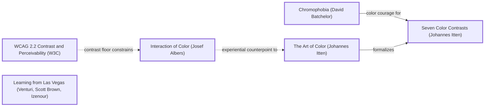

# DESIGN-LOG: website-toolkit (DADA run, 2026-11-11)

## Traversal Plan

**Brief:** "Site repo is b plus good design boring colors do a new color version in this repo" (the owner, verbatim). Make a new colour version of the site-repo kit in a new repository, keeping the design the owner graded B+.

**Mode: Adaptive.** The site serves people and agents.

**Run type: Full**, with the design held constant by the brief: layout, parts, sprue, X-ray and sandbox stay; colour is free. Moves outside colour are limited to measured defects inherited from site-repo's R2 panel.

**Bound:** none stated.

**Lineage:** site-repo, whose DADA log and panels R0–R2 are in SolutionsAsService/site-repo (DESIGN-LOG.md, panel/). Its open findings are this run's starting Frontier.

### Tooling

The tools are the same as for site-repo:
- Mermaid text in the log
- one Agent sub-agent per seat, three at a time, filing to panel/<round>/
- collect_panel.py and pick_panel.py
- Playwright through build/check.mjs
- the ledger in SolutionsAsService/dada-changes (the owner's account)

### Panel (pick_panel.py --mode adaptive --run-type full --project website-toolkit)

| Seat | Why |
|---|---|
| Critic: Provocateur (Debord) | required |
| Critic: Provocateur (Shklovsky) | required |
| Critic: Inclusion (Holmes) | required |
| Critic: Inclusion (Mace) | required |
| Critic: Evidence (Cairo) | required, measurement |
| Critic: Usability (Krug) | rated |
| Critic: Craft (Bringhurst) | rated |
| Critic: Semiotic (Eco) | rotation, 0 rounds on record |

Dotted pairs: Debord–Krug, Shklovsky–Krug.

### Seed

- **Stance:** Chromophobia (David Batchelor). Diagnosis: the B+ was withheld for fear of colour ("boring colors").
- **Rules:**
  - The Art of Color (Johannes Itten) -->|formalizes| Seven Color Contrasts (Johannes Itten).
  - WCAG 2.2 Contrast and Perceivability (W3C).
- **Breaker:** Learning from Las Vegas (Venturi, Scott Brown, Izenour). Colour as the sign of the decorated shed.
- **Counterpoints (dotted):**
  - `albers -.->|experiential counterpoint to| itten`: Interaction of Color (Josef Albers).
  - `wcag -.->|contrast floor constrains| albers`.

Chain:

> Chromophobia (David Batchelor) -->|color courage for| Seven Color Contrasts (Johannes Itten) · The Art of Color (Johannes Itten) -->|formalizes| Seven Color Contrasts (Johannes Itten) · Interaction of Color (Josef Albers) -.->|experiential counterpoint to| The Art of Color (Johannes Itten) · WCAG 2.2 Contrast and Perceivability (W3C) -.->|contrast floor constrains| Interaction of Color (Josef Albers).

### Initial Frontier

| Candidate | Reached via | Status |
|---|---|---|
| The owner's grade: colour | premortem (R0) | TAKEN (M1–M3) |
| Contrast of hue as the organizing contrast (one colour per group) | itten -->\|formalizes\| itten7 | TAKEN (M2) |
| Colour courage on the first screen | chromo -->\|color courage for\| itten7 | TAKEN (M1) |
| Colours judged in context, not in isolation (each colour beside its neighbours) | albers -.-> itten | TAKEN (M3: four part themes checked in place) |
| The contrast floor | wcag -.-> albers | TAKEN (M4: chrome contrast probed) |
| site-repo R2 open findings | inherited panel | TAKEN (M5) |

## Panel, round R0 (inherited premortem)

No new R0 panel was convened. The inherited artifact had just been judged by site-repo's R2 panel (7 of 8 seats filed at the time of copying; Mace's file was still out). The owner then graded it B+, with words naming the defect: "good design boring colors". Recorded as inherited, not re-run:

| Critic | Anchor used | Observed in the work | Verdict | Requested change |
|---|---|---|---|---|
| Critic: Evidence (Cairo) | How Charts Lie | stats.html claims a check that does not exist; the ring branch has no failing fixture; `\b` slot matching | OBJECT | Probe or drop; fixture; exact tokens |
| Critic: Provocateur (Debord) | Society of the Spectacle | "Speakers" leads to a testimonial; the untested "five minutes" | PASS | Rename; drop the timing |
| Critic: Inclusion (Holmes) | Mismatch | Bare unglossed on the phone; on the phone the visual order differs from the DOM order | PASS | Gloss; DOM order |
| Critic: Usability (Krug) | Don't Make Me Think | Phone switches unlabelled; sparse miniatures | PASS | Labels; zoom |
| Critic: Craft (Bringhurst) | Elements of Typographic Style | Step numerals past the margin; widows; .chk about 80 characters per line; no scale | PASS | Fixes; a scale |
| Critic: Provocateur (Shklovsky) | Art as Technique | Bare answered; tags unreadable at miniature scale | PASS | Optional zoom |

### Resolutions R0

| Finding | Resolution |
|---|---|
| Owner: boring colours | ADAPT (M1–M3) |
| Cairo: stats claim without a probe | ADAPT (M5): probe "every stat has a source line", with a failing fixture |
| Cairo: ring branch untested | ADAPT (M5): the fixture has a 2 px ring at 1.1:1 and it fails |
| Cairo: `\b` slot match | ADAPT (M5): exact whitespace tokens |
| Debord: Speakers; five minutes | ADAPT (M5): "Voices"; "step by step" |
| Holmes: phone gloss; order | ADAPT (M5): one-line gloss on the phone; the doors follow the frame in the DOM; the reorder is gone |
| Krug: phone labels; sparse miniatures | ADAPT (M5): "Theme"/"View" labels on the phone; narrower virtual widths for nav, breadcrumb and dividers |
| Bringhurst: numerals, widows, measure | ADAPT (M5): padding 2.4em; `text-wrap: pretty`; .chk 34em |
| Bringhurst: type scale | DEFERRED (Open frontier) |
| Shklovsky: tags unreadable in Bare at miniature scale | DEFERRED (the part pages carry the full X-ray) |

## Decision Records

## Move M1: Ultramarine and acid yellow  (BREAK)
Depends on: none
Anchors: Stance Chromophobia (David Batchelor) | Breaker Learning from Las Vegas (Venturi, Scott Brown, Izenour)
Intent:
- The landing band and the header become ultramarine (#2330d6).
- The frame, runners and pressed controls become acid yellow (#e4ff3a).
- Text on the band is white (7.7:1), and secondary text is #dfe2ff (6.4:1).
- Content pages move from beige to a violet-white (#f7f5ff); code blocks become deep blue; the footer becomes ink with yellow links.
Formal argument: Batchelor: the B+ was the fear of colour, so colour carries the whole sign of the shed (Venturi). The structure the owner liked is untouched.
Alternatives rejected:
- (a) A brighter orange on beige. Rejected: the same palette, louder.
- (b) A dark mode. Rejected: dark is not colour.
- (c) A gradient. Rejected: it fights the parts' own colours.
Consequence: The parts' own colours sit on a strong ground, so the tiles stay white with ink borders to separate them.
Fence: Quiet chrome exists so the content leads. The frame is loud, and the tiles are still white.
Frontier effect: chrome contrast must be measured (M4).
Mode field: The advanced pole is a saturated, two-colour ground. The acceptable pole is white tiles and white text at 7.7:1.

## Move M2: One colour per group  (KEEP-THE-RULE)
Depends on: M1
Anchors: Rule Seven Color Contrasts (Johannes Itten) (contrast of hue) | Rule The Art of Color (Johannes Itten)
Intent: The seven runner tags, the part-code chips and the parts index letters each take a hue:
- A coral
- B pink
- C mint
- D sky
- E amber
- F lilac
- G yellow

All carry ink text, so hue is a second channel and never the only one, since the letters stay.
Formal argument: Itten's contrast of hue is the strongest of the seven when the hues are saturated and separated, and it makes the groups findable at a glance.
Alternatives rejected:
- (a) One accent for all groups. Rejected: no wayfinding.
- (b) Tints of blue. Rejected: too close.
Consequence: Seven hues plus the ground must each hold ink text at 4.5:1 or better.
Fence: n/a.
Frontier effect: the forced-colours check.
Mode field: The advanced pole is a seven-hue kit. The acceptable pole is the letters still there.

## Move M3: Four new part themes  (KEEP-THE-RULE)
Depends on: none
Anchors: Counterpoint Interaction of Color (Josef Albers) (dotted from The Art of Color)
Intent: Replace Paper, Night, Citrus and Slab with:
- **Signal** (default): warm white, violet #5a2ee5, lilac surfaces.
- **Riso**: fluoro pink #d6005f on yellow.
- **Cobalt**: dark, with an acid-yellow accent.
- **Mint**: deep green #007a52 on mint.

The parts' built-in fallbacks move to Signal.
Formal argument: Albers says colour is judged in its neighbours. Each theme is checked with every part rendered in it, not swatch by swatch.
Alternatives rejected:
- (a) Keep the old themes and add one. Rejected: the default would still be beige.
- (b) Theme-free parts. Rejected: tokens are the programme.
Consequence: The theme switch and the sandbox presets change names. The sandbox hash uses `th=riso` and similar.
Fence: n/a.
Frontier effect: the check runs every part in every theme.
Mode field: The advanced pole is fluoro and dark themes. The acceptable pole is a calm default (Signal).

## Move M4: Measure the chrome  (KEEP-THE-RULE)
Depends on: M1, M2
Anchors: Rule WCAG 2.2 Contrast and Perceivability (W3C) (dotted "contrast floor constrains" Albers)
Intent: The text-contrast probe now runs on the site's own 25 pages as well as on the parts. Disabled controls are exempt (WCAG 1.4.3).
Formal argument: A new palette must prove its floor, not assert it in comments.
Alternatives rejected:
- (a) Trust the hand calculations in the CSS comments. Rejected: they are comments, not measurements.
Consequence: The first run found the disabled ↑/↓ at 1.98:1, which is exempt under 1.4.3, so the probe now skips disabled controls.
Fence: n/a.
Frontier effect: none.
Mode field: n/a.

## Move M5: Inherited fixes  (KEEP-THE-RULE)
Depends on: M1
Anchors: Rule WCAG 2.2 Contrast and Perceivability (W3C)
Intent: The R0 resolutions above, item by item.
Formal argument: Each is a measured defect from site-repo R2.
Alternatives rejected:
- (a) Leave them in site-repo. Rejected: this repo is the version going forward.
Consequence: About 15 small edits.
Fence: n/a.
Frontier effect: R1 re-judges them.
Mode field: n/a.
